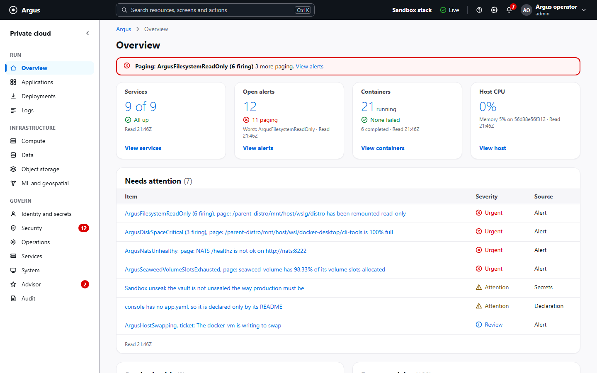
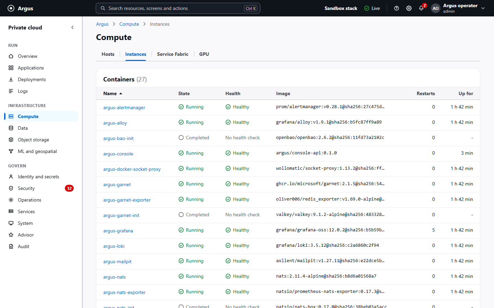
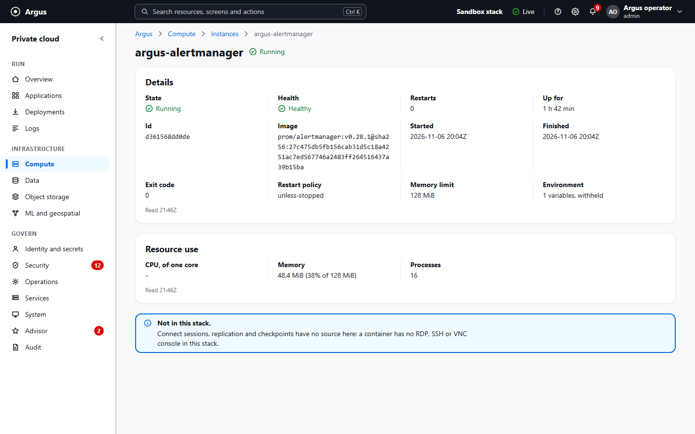
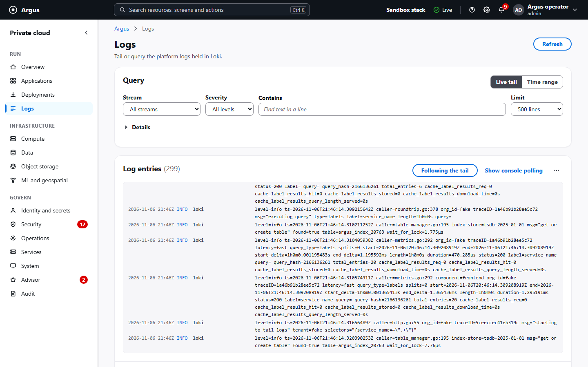
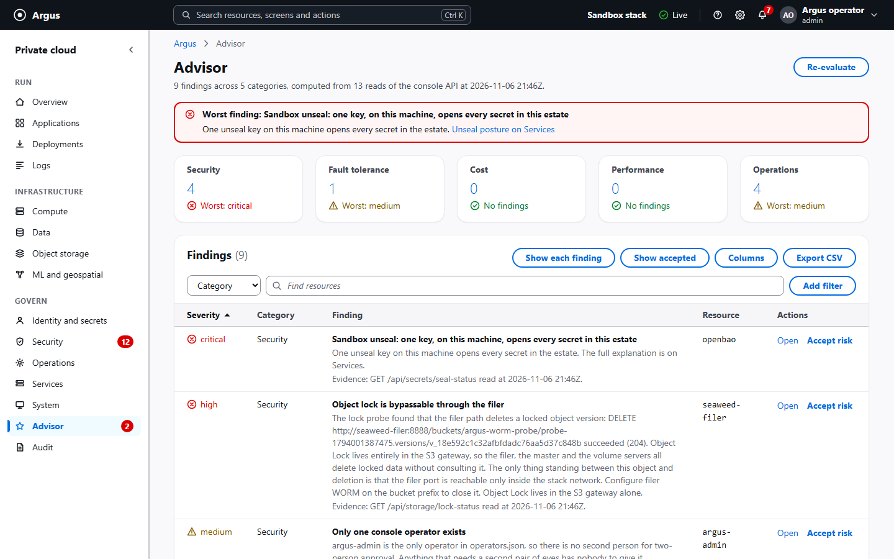
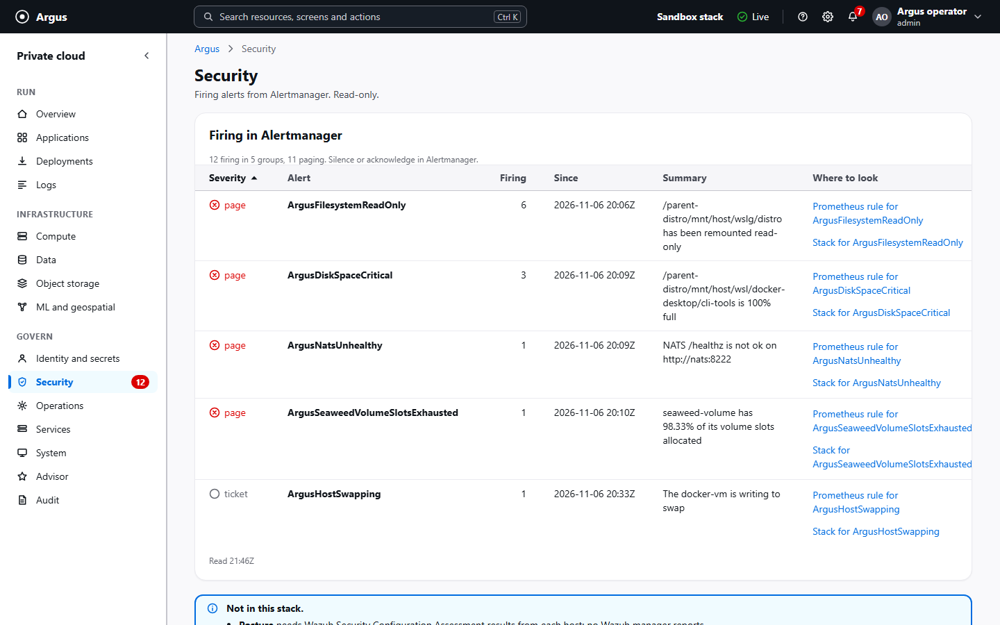
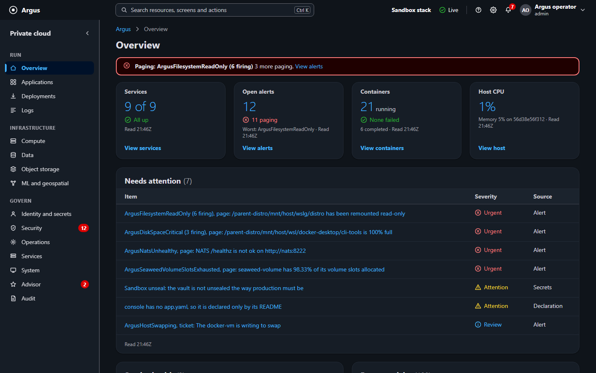
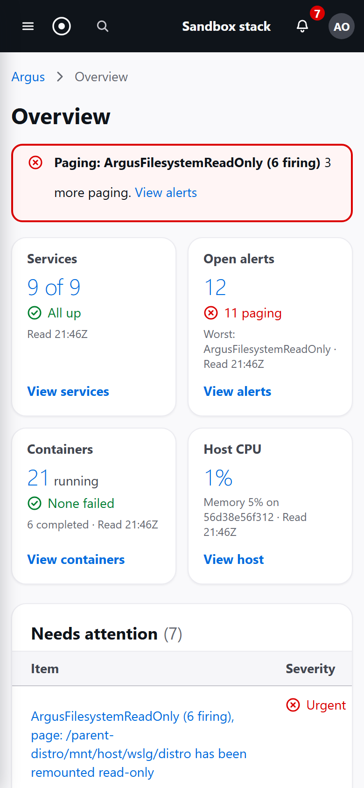
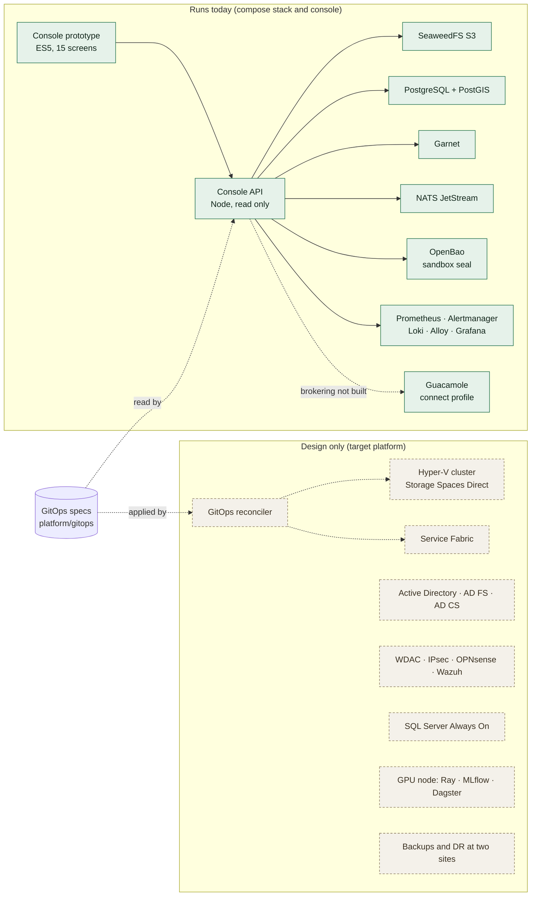

<div align="center">

# Argus

### A reference design for running a mid-sized organisation's AWS workloads on Windows Server hardware it owns, with a working console prototype

**Windows Server · Hyper-V · Service Fabric · Active Directory · GitOps · zero trust**

[](https://github.com/Adilmunawar/argus/actions/workflows/validate.yml)
[](docs/01-DECISIONS.md)
[](LICENSE)
[](CHANGELOG.md)

[What runs today](#what-runs-today) · [Quick start](#quick-start) · [Architecture](#architecture) · [Roadmap](#roadmap) · [Documentation](#documentation) · [Contributing](#contributing) · [License](#license)

</div>

> **Not open source.** You may read this repository on GitHub. Any other use, including running it, needs the author's written permission: see [License](#license).

Argus is a design record for one specific job: moving a mid-sized organisation that runs a handful of line-of-business applications and an ML workload off AWS and onto two sites of hardware it owns, with Windows Server as the base. The sample applications are Orders, Billing and Maps. The record is thirty-five architecture decisions, an application-to-infrastructure map, a security architecture, a hardware and licensing estimate, and a phased plan with exit gates.

Most of it is not built. None of the Windows Server platform (Hyper-V, Service Fabric, Active Directory, WDAC, IPsec, the GitOps reconciler) exists yet. What does exist is a web console prototype, a small read-only console API, a Docker Compose stack of the open-source pieces, and the tests and CI checks around them. The [validation status](docs/09-VALIDATION-STATUS.md) says, component by component, what has been executed and what is still a design. Read it before relying on anything here.

## What runs today

| Feature | Status | Notes |
|---|---|---|
| Console sign-in, sessions, roles, sign-out | Live | Session cookie against an operator file, with four roles (viewer, operator, security, admin). Works without Docker (see the quick start) |
| All fifteen console screens, signed in | Live, read only | Every screen reads the console API: SeaweedFS, PostgreSQL, Garnet, NATS, OpenBao, Prometheus, Alertmanager, Loki, the container socket proxy, the GitOps specs and the runbooks. What this stack does not have (Hyper-V hosts, Service Fabric, Active Directory grants, the reconciler, the GPU node, drills, cost) is shown as "Not in this stack", never as a sample figure |
| The same screens from `file://` | Sample mode only | Eleven screens run on the bundled dataset. Data, Object storage, Services and System have no fixtures and say so |
| Any change: approve or reject a deployment, grant access, rotate or revoke a secret, freeze changes, two-person approval, silence an alert, open an incident, edit tags, act on a VM | Sample mode only | The console is read only. The API has no write routes besides sign-in and sign-out, so these flows change the bundled dataset in the browser and nothing else. They are the interaction design for write paths that wait on the reconciler |
| Audit trail with a hash chain | Live, with a limit | The chain is computed in the page over the API's in-memory ring of its own events. It shows rows were not altered on the way to the page, not that the API's memory was not altered |
| Browser RDP and SSH | Sample mode only | The session drawer is simulated. Apache Guacamole runs in the compose `connect` profile, but the console does not broker sessions to it yet (ADR-0032) |
| Just-in-time elevation, idle lock | Sample mode only | The countdown runs against the sample clock; "resumed by a security key" is a button, with no WebAuthn behind it |
| Command palette, filters in the URL, saved views, column picker, CSV export, keyboard tables, light and dark themes | Both modes | Interface features; they need no server |
| PowerShell module `Argus` | Live, read only | A client of the console API with the same sign-in; analysed and tested in CI |
| S3 parity harness (SeaweedFS against LocalStack) | Live, unrecorded | Runs in the compose `parity` profile; no run is committed as evidence |
| Windows Server platform: Hyper-V, Storage Spaces Direct, Service Fabric, AD, AD FS, AD CS, WDAC, IPsec, OPNsense, Wazuh, backups and DR, the reconciler, the GPU node | Design only | Documented in `docs/`; GitOps specs and one OpenTofu module exist as files |

*Live* means it works against the compose stack. *Sample mode only* means it works on the bundled dataset and has no server path. *Design only* means documented, not built.

<p align="center">
  
</p>

<table>
<tr>
<td></td>
<td></td>
</tr>
<tr>
<td></td>
<td></td>
</tr>
<tr>
<td></td>
<td></td>
</tr>
<tr>
<td colspan="2" align="center"></td>
</tr>
</table>

The screenshots are the console signed in to the compose stack on a Windows laptop. The alerts in them are real ones from that machine (a Docker Desktop disk, a sandbox unseal), which is the point: nothing on screen is a fixture. The visual language is specified in [the console design system](docs/13-CONSOLE-DESIGN-SYSTEM.md).

## At a glance

<table>
<tr><td><b>Replaces (by design)</b></td><td>EC2, S3, RDS, Cognito, IAM, Secrets Manager, KMS, Lambda, SQS and SNS, ElastiCache, CloudWatch, X-Ray, ECR, CodePipeline, SageMaker</td></tr>
<tr><td><b>Platform base</b></td><td>Windows Server 2025 Datacenter · Hyper-V · Failover Clustering · Storage Spaces Direct · Service Fabric · Active Directory</td></tr>
<tr><td><b>Security design</b></td><td>Hardware root of trust, WDAC code integrity, IPsec domain isolation, no standing admin rights, object-locked backups at two sites</td></tr>
<tr><td><b>Control surface</b></td><td>Web console (an ES5 prototype and a Node API today, ADR-0035) · <code>Argus</code> PowerShell module · a GitOps repository meant to be the only writer of production</td></tr>
<tr><td><b>Targets</b></td><td>RPO 15 minutes · RTO 8 hours for full site loss · 99.9% availability · under 10 minutes from <code>git push</code> to a signed production deploy. None has been measured</td></tr>
<tr><td><b>Linux exceptions</b></td><td>Three hosts, each justified by an ADR: the GPU node, the Wazuh SIEM manager and the Guacamole gateway. OPNsense firewalls are appliances, not servers.</td></tr>
<tr><td><b>Status</b></td><td>Design, with a working console prototype and local stack. Latest release v0.12.0 (11 October 2026); <code>main</code> carries unreleased work listed in the changelog</td></tr>
</table>

## What is in the repository

### The design
* **[35 architecture decision records](docs/01-DECISIONS.md)** covering compute, storage, identity, secrets, networking, observability, backups, CI/CD and machine learning. Each has a Status and a Date; eighteen list the options weighed, and the rest give the decision and its reasons.
* **[Application infrastructure map](docs/02-APPLICATION-INFRASTRUCTURE-MAP.md)** tracing each sample workload to its service account, bucket, port, certificate and backup.
* **[Security architecture](docs/03-SECURITY-ARCHITECTURE.md)** with a threat model, controls and the evidence each control is meant to produce.
* **[Hardware and licensing](docs/07-HARDWARE-AND-LICENSING.md)**: a bill of materials and the one cost table, as list-price estimates.
* **[Phases with exit gates](docs/06-PHASES-AND-RUNBOOKS.md)** and one runbook so far, the [day-one lab](docs/runbooks/boot-01-day-one.md). The other runbooks are listed, not written.

### The local stack
* A Docker Compose stack with **OpenBao** (sandbox seal), **SeaweedFS** S3-compatible object storage, **PostgreSQL with PostGIS**, **Garnet**, **NATS JetStream**, **Prometheus**, **Grafana**, **Loki**, **Alertmanager**, **Grafana Alloy**, and optional profiles for **Apache Guacamole**, **Nomad** and an S3 parity harness.
* An **S3 parity harness** that runs the same legs against SeaweedFS and, optionally, LocalStack, and reports where they conform and where they differ.
* An **`Argus` PowerShell module** that reads the stack through the console API.

### The console prototype
* Fifteen screens on one layout (top bar, side navigation, breadcrumbs, page header), a command palette, sortable and token-filtered tables and deep links. The visual language is a white, dense, Cloudscape-style system specified in [docs/13](docs/13-CONSOLE-DESIGN-SYSTEM.md).
* Signed in, every screen reads the stack and says when a source is missing. Every figure carries the time it was read.
* In sample mode, actions carry state: approving, granting, rotating or freezing changes the next screen, the audit rows and the navigation counts, and reversible actions offer Undo. This is the interaction design for the write paths, not a write path.
* Operator-grade tables with bulk selection, keyboard row navigation, a remembered column picker and CSV export of exactly the rows shown.
* An Advisor with rules over security, fault tolerance, cost, performance and operations. Signed in, they run over thirteen reads of the API; in sample mode, over the dataset.
* No `innerHTML` anywhere, a strict Content Security Policy, no network requests outside its own origin, and ES5 classic scripts so it opens from `file://` with no build.

### The tests

| Suite | Command | What it proves |
|---|---|---|
| Property suite, `run-tests.js` | `npm test` | 423 assertions in headless Chromium against the rendered DOM: axe-core WCAG 2.1 and 2.2 A and AA on every screen and overlay, keyboard traversal and focus trapping, contrast from rendered pixels, six viewport widths, WCAG 1.4.10 reflow at 200% and 400%, laptop density, layout leaks, and a source pass proving `innerHTML` appears nowhere |
| Live suite, `live.js` | `npm run test:live` | 386 checks with the console API started on temporary operators: sign-in, a wrong password, roles, all fifteen screens over http, a matrix of upstream faults, reload, an expired session, sign-out and the server's audit trail. No Docker. Pointed at the composed stack it runs 378 checks against the real services |
| Sandbox, `sandbox.js` | `npm run test:sandbox` | 125 checks across nine viewport, theme and density environments |
| Stress, `stress.js` | `npm run test:stress` | Performance and retention budgets: data at scale, memory and listener leaks, interaction latency, sustained use, flashes, a soak, search, the session player, scrolling and parallel tabs |
| Console API | `npm test` in `platform/console/server` | 346 checks: sessions, password hashing, roles, throttling and lockout, origin checks, the error envelope, streams, the storage and GitOps readers |

On every push CI runs these suites, the PowerShell module's analysis and Pester tests, the console image build and scan, configuration and OpenTofu checks, a link check over the Markdown, and the repository invariants (schemas, parsers, no comments in code, no committed credentials, no private names). A separate compose job brings the whole stack up, waits for it to be healthy and runs the live suite against it.

## Quick start

**1. The prototype, sample mode.** No build, no server, no network. From the repository root:

```bash
# Windows (PowerShell or cmd)
start platform\console\prototype\index.html
# macOS
open platform/console/prototype/index.html
# Linux
xdg-open platform/console/prototype/index.html
```

Eleven screens run on the bundled dataset. Data, Object storage, Services and System have no fixtures, so from `file://` they say there is nothing to read.

**2. Live mode without Docker.** The console API serves the prototype and signs you in. It needs Node 22 or later:

```bash
cd platform/console/server
npm ci
printf '%s\n' 'a long password for local use' | npm run --silent hash-operator-password > hash.txt
```

Write an operator file outside the repository, for example `operators.local.json`, with the line from `hash.txt` as the password:

```json
{ "operators": [ { "subject": "operator-a", "displayName": "Operator A", "roles": ["admin"], "password": "<the line in hash.txt>" } ] }
```

Then start the API and open http://127.0.0.1:8787:

```bash
# bash
export ARGUS_AUTH_OPERATORS_FILE=/path/to/operators.local.json
export ARGUS_GITOPS_DIR=../../gitops ARGUS_RUNBOOKS_DIR=../../../docs/runbooks
npm start
# PowerShell
$env:ARGUS_AUTH_OPERATORS_FILE = 'C:\path\to\operators.local.json'
$env:ARGUS_GITOPS_DIR = '../../gitops'; $env:ARGUS_RUNBOOKS_DIR = '../../../docs/runbooks'
npm start
```

The API binds to 127.0.0.1:8787 by default. The two directory settings let the Applications, Deployments and Operations screens read the GitOps specs and runbooks in this checkout. With nothing else running, the live screens say which upstream is missing. The [server README](platform/console/server/README.md) lists every setting, the routes and the roles.

**3. The full local stack.** Docker Desktop or Docker Engine with Compose v2, then from the repository root:

```bash
node platform/compose/stack.js bootstrap
node platform/compose/stack.js up --wait
```

Sign in at http://127.0.0.1:8787 as `argus-admin`; the password is in `platform/compose/secrets/console_operator_password` and is never printed. `node platform/compose/stack.js status`, `logs`, `doctor`, `down` and `reset` are described in the [compose README](platform/compose/README.md).

**Run the tests:**

```bash
npm ci
npx playwright install chromium
npm test            # property suite
npm run test:all    # property, live, sandbox and stress
```

### Before anyone buys hardware

The [day-one lab runbook](docs/runbooks/boot-01-day-one.md) is five days on one spare machine that test the three assumptions most likely to be wrong (Service Fabric on Windows Server 2025, SeaweedFS on Windows, Guacamole with one-time credentials). It costs a Windows evaluation licence and a week. Tier 1 hardware is estimated at $85k to $110k in [the cost table](docs/07-HARDWARE-AND-LICENSING.md); ordering it before the lab risks that sum on an untested design.

## Architecture



<table>
<tr><th>Layer</th><th>Argus component</th><th>Status</th><th>AWS equivalent</th></tr>
<tr><td>Compute</td><td>Hyper-V failover cluster, Service Fabric</td><td><i>design only</i> (Nomad runs in the compose <code>compute</code> profile as a stand-in)</td><td>EC2, ECS, Lambda</td></tr>
<tr><td>Storage</td><td>Storage Spaces Direct; SeaweedFS</td><td>S2D <i>design only</i>; SeaweedFS <i>in the stack</i></td><td>EBS, S3</td></tr>
<tr><td>Databases</td><td>SQL Server; PostgreSQL with PostGIS</td><td>SQL Server <i>spec only</i> (one OpenTofu module); PostgreSQL <i>in the stack</i></td><td>RDS</td></tr>
<tr><td>Cache and messaging</td><td>Garnet, NATS JetStream</td><td><i>in the stack</i></td><td>ElastiCache, SQS, SNS</td></tr>
<tr><td>Identity</td><td>Active Directory, AD FS, tiered administration</td><td><i>design only</i> (the console has its own operator file and roles meanwhile)</td><td>IAM, Cognito</td></tr>
<tr><td>Secrets and PKI</td><td>OpenBao; AD CS</td><td>OpenBao <i>in the stack</i> with a sandbox seal; AD CS <i>design only</i></td><td>Secrets Manager, KMS, ACM</td></tr>
<tr><td>Edge and network</td><td>Caddy with Coraza WAF, YARP, OPNsense HA with CrowdSec, IPsec</td><td>IPsec rules <i>spec only</i>; the rest <i>design only</i></td><td>ALB, WAF, Security Groups</td></tr>
<tr><td>Observability</td><td>Prometheus, Grafana, Loki, Alertmanager, Alloy; OpenTelemetry, Sysmon, Wazuh</td><td>Prometheus to Alloy <i>in the stack</i>; OpenTelemetry, Sysmon and Wazuh <i>design only</i></td><td>CloudWatch, X-Ray, GuardDuty</td></tr>
<tr><td>Delivery</td><td>GitHub Actions on self-hosted runners, Forgejo mirror, first-party GitOps reconciler, OpenTofu, DSC v3</td><td>GitOps specs and schemas <i>spec only</i>; reconciler, runners, Forgejo and DSC <i>design only</i></td><td>CodePipeline, CloudFormation</td></tr>
<tr><td>Remote access</td><td>Apache Guacamole browser RDP and SSH</td><td>Guacamole <i>in the stack</i> (<code>connect</code> profile); brokering from the console <i>design only</i></td><td>Systems Manager Session Manager</td></tr>
<tr><td>Machine learning</td><td>Dedicated GPU node</td><td><i>design only</i></td><td>SageMaker</td></tr>
<tr><td>Console</td><td>ES5 prototype and Node API</td><td><i>in the stack</i></td><td>AWS Management Console</td></tr>
</table>

*In the stack* means it runs in the compose stack. *Spec only* means there are files with a schema or a module, but nothing applies them. *Design only* means it is documented and nothing more.

### Repository layout

<table>
<tr><td><code>docs/</code></td><td>The plan. Start with <a href="docs/09-VALIDATION-STATUS.md">the validation status</a>.</td></tr>
<tr><td><code>docs/adr/</code></td><td>One file per architecture decision, numbered. These files are the record.</td></tr>
<tr><td><code>docs/runbooks/</code></td><td>The format for runbooks and one runbook, the day-one lab. The rest are listed in docs/06.</td></tr>
<tr><td><code>platform/console/</code></td><td>The console: <code>prototype/</code> and <code>server/</code> run; <code>src/</code> holds placeholders for the target design.</td></tr>
<tr><td><code>platform/cli/</code></td><td>The <code>Argus</code> PowerShell module, a client of the console API.</td></tr>
<tr><td><code>platform/compose/</code></td><td>The local stack for development and parity testing.</td></tr>
<tr><td><code>platform/gitops/</code></td><td>Desired-state specs (apps, environments, service accounts, buckets, OpenBao policies) and their schemas. Nothing applies them yet.</td></tr>
<tr><td><code>platform/policies/</code></td><td>The IPsec rule specification. WDAC, GPO and Wazuh directories are placeholders with a README each.</td></tr>
<tr><td><code>platform/iac/</code></td><td>One OpenTofu module for <code>sql-01</code>. The DSC configurations it describes are not written.</td></tr>
<tr><td><code>CHANGELOG.md</code></td><td>Every change, dated, with the reason.</td></tr>
</table>

## Roadmap

From the phases in [docs/06](docs/06-PHASES-AND-RUNBOOKS.md). A phase is done when its exit gate passes and the report is committed.

| Step | Delivers | State |
|---|---|---|
| Design record | ADRs, application map, security architecture, network, hardware and licensing, phases | Done; revised as decisions change |
| Console prototype and API | Fifteen screens, sign-in, read-only live mode, four browser suites and the server tests | Done for reads; writes wait for the reconciler |
| Local stack | The open-source components in Docker Compose, with the console reading them | Done, verified locally |
| Day-one lab | Service Fabric, SeaweedFS and Guacamole proven on one Windows Server 2025 machine | Not started |
| Phase 0, Foundation | Hardware, AD forest, Hyper-V and S2D cluster, Service Fabric, OpenBao, AD CS, observability | Not started |
| Phase 1, Storage and backups | SeaweedFS at both sites, object-locked backups, the first restore drill | Not started |
| Phase 2, Orders cutover | The Orders sample application on Service Fabric at 99.9% for 14 days | Not started |
| Phase 3, ML and geospatial | The GPU node, the Sentinel mirror, the ML pipelines | Not started |
| Phase 4, Database and apps | SQL Always On to Site B, mobile apps on the new endpoint | Not started |
| Phase 5, DR and exit | Full Site B, the first DR drill, the AWS account closed | Not started |
| Phase 6, Hardening and audit | WDAC enforced, an external penetration test, the evidence pack | Not started |

## Documentation

1. **[Validation status](docs/09-VALIDATION-STATUS.md): what is tested, what is not, and how to check.**
2. [Master plan](docs/00-MASTER-PLAN.md): what is to be built, the targets, the phases.
3. [Decisions](docs/01-DECISIONS.md): the ADR index, with a summary of each.
4. [Application infrastructure map](docs/02-APPLICATION-INFRASTRUCTURE-MAP.md): each sample application down to its service account, bucket, port and backup.
5. [Security architecture](docs/03-SECURITY-ARCHITECTURE.md): controls, threat model and evidence.
6. [Network and sites](docs/04-NETWORK-AND-SITES.md): zones, VLANs, addressing and the two sites.
7. [Control plane](docs/05-CONTROL-PLANE.md): the target design for the console, the CLI and the GitOps flow.
8. [Phases and runbooks](docs/06-PHASES-AND-RUNBOOKS.md): the schedule with exit gates.
9. [Hardware and licensing](docs/07-HARDWARE-AND-LICENSING.md): bill of materials, licensing and the cost table.
10. [Open questions](docs/08-OPEN-QUESTIONS.md): decisions still needed.
11. [Console design](docs/10-CONSOLE-DESIGN.md): every screen, including browser RDP.
12. [Console UX benchmark](docs/11-CONSOLE-UX-BENCHMARK-AND-BUGS.md): the AWS, GCP and Azure comparison and the bug register.
13. [Console stress and performance](docs/12-CONSOLE-STRESS-AND-PERFORMANCE.md): budgets and results.
14. [Console design system](docs/13-CONSOLE-DESIGN-SYSTEM.md): the tokens, layout and components the console uses.

## How changes happen

A new component, a removed one, a changed port or a changed key policy is an ADR in `docs/adr/`, a line in the changelog, and a change under `platform/`, in one commit. The git history is meant to answer "why is it like this?".

## Contributing

Issues are welcome; pull requests are not accepted. The most useful issue proves an assumption wrong or challenges a decision: use the *An assumption turned out wrong* or *Challenge a decision* template. The [contributing guide](CONTRIBUTING.md) explains why, and the [code of conduct](CODE_OF_CONDUCT.md) and [security policy](SECURITY.md) say how to report anything else.

## Related projects

* [QGIS MCP](https://github.com/Adilmunawar/QGIS_MCP): a Model Context Protocol server that connects AI assistants to QGIS.

## Author

Built and maintained by **[Adil Munawar](https://github.com/Adilmunawar)**, ML Research and Development. Portfolio: [adilmunawar.vercel.app](https://adilmunawar.vercel.app).

## License

Copyright © 2026 Adil Munawar. **All rights reserved.**

This repository is **not** open source and carries no open source licence. You may read it on GitHub. Any other use, including running the console or the compose stack, copying the documents, deploying the design, building a derivative, or using any of it to train a model, requires the author's **prior written permission**, granted case by case.

To ask, email adilmunawarx@gmail.com or contact [Adil Munawar on GitHub](https://github.com/Adilmunawar) with who you are, what you want to use, and for what. Silence is not permission. The full terms are in [LICENSE](LICENSE); what is usually granted, and how to ask, is in the [use and permission policy](USE-POLICY.md). The name is reserved under [TRADEMARK.md](TRADEMARK.md), and copies published without permission are handled under [ENFORCEMENT.md](ENFORCEMENT.md).

Versions published before 1 November 2026 were MIT licensed; copies obtained under that licence keep that licence. Third-party components referenced or bundled here stay under their own licences.

If Argus was useful to you, a star helps other engineers planning the same move find it.
